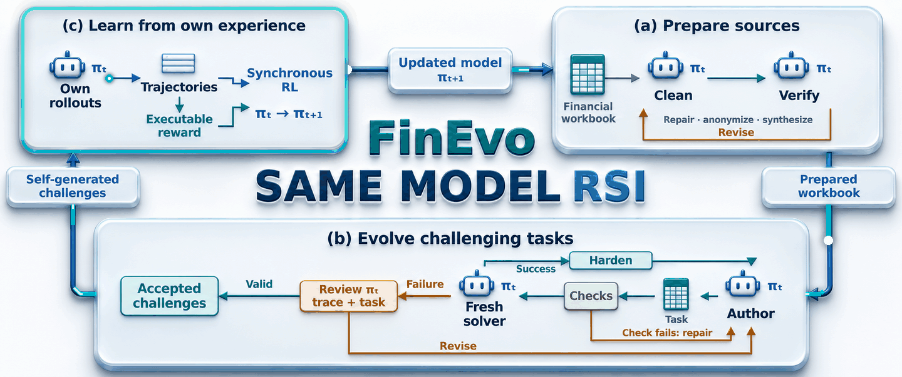

# FinEvo



**Self-Generated Challenging Tasks for Recursive Self-Improvement of Financial Spreadsheet Agents**

**English** · [简体中文](README.zh-CN.md)

[Citation](#citation) · [Quick start](#quick-start) · [Explore the 20 tasks](examples/README.md) · [Generate challenges](generation/README.md) · [Train the agent](training/README.md)

**The model helps create the challenges it learns from.**

One wrong formula can ripple through a forecast, a balance sheet, and a company's valuation. A financial spreadsheet agent has to follow those business relationships across an entire workbook. FinEvo turns that same workbook into a source of new challenges—and learning experience—for the model itself.

Start with a complete financial model. Let the agent build or repair it. Use what happened to improve the next challenge, then train on the accepted tasks with **synchronous GRPO**.

| Build the challenge | Learn from the attempt | Improve the agent |
| --- | --- | --- |
| Construct modeling and debugging tasks from complete workbooks. | Read successful trajectories to harden tasks; review failures to identify task issues. | Train on the model's own tool interactions with executable rewards. |

The default target model is **Qwen3.6-27B**, running through **OpenHands**. This repository includes the generation, evaluation, and training code, plus **two financial-statements workbooks and 20 tasks** to explore.

## How it works

1. **Prepare a financial model.** Separate cleaning and verification contexts check the workbook's business relationships and prepare it for task construction.
2. **Evolve challenging tasks.** Construct modeling or debugging tasks, check their executable artifacts, and solve them in fresh contexts. Successful trajectories guide hardening; failed checks and solver-failure reviews guide reconstruction or revision. Reviewed valid challenges are accepted.
3. **Learn from self-generated experience.** Collect tool-use trajectories on the accepted tasks and optimize the model with binary task rewards. Synchronous sampling keeps every training batch aligned with the current policy.

The two included financial-statements workbooks are already prepared and can be used directly for generation. The same-model cleaning and verification pipeline is available for new source workbooks.

## Two workbooks. Twenty challenges.

Explore two fictional companies through linked income statements, balance sheets, cash flows, operating drivers and segment schedules. Each source includes **five modeling tasks and five debugging tasks**:

| Source | Complete workbook | Modeling tasks | Debugging tasks |
| --- | --- | --- | --- |
| **financialstatements1** | [Workbook](examples/financialstatements1/reference.xlsx) | [Browse 5 tasks](examples/financialstatements1/tasks/) | [Read a debugging task](examples/financialstatements1/tasks/financialstatements1-debugging-001/instruction.md) |
| **financialstatements2** | [Workbook](examples/financialstatements2/reference.xlsx) | [Browse 5 tasks](examples/financialstatements2/tasks/) | [Read a debugging task](examples/financialstatements2/tasks/financialstatements2-debugging-001/instruction.md) |

Every task includes an input workbook, instructions, a reference solution, and a fixed verifier. [Browse the example data →](examples/README.md)

## Repository contents

| Component | Contents | Guide |
| --- | --- | --- |
| `generation/` | Cleaning, verification, task construction, hardening, and review | [Generation](generation/README.md) |
| `evaluation/` | Independent Harbor evaluation and reporting | [Evaluation](evaluation/README.md) |
| `training/` | Synchronous GRPO, pinned runtime adapters, and training configurations | [Training](training/README.md) |
| `examples/` | Two prepared workbooks and 10 modeling + 10 debugging tasks | [Example data](examples/README.md) |
| `results/` | Main-paper learning-curve and generation-progress summaries | [Results](results/README.md) |
| `scripts/` | Source registration, query scheduling, controller setup, and release validation | [Scripts](scripts/) |

## Quick start

### 1. Install

Use **Python 3.12**. Executing spreadsheet tasks also requires Docker and LibreOffice. Generation and solver evaluation use a model endpoint; GPU training uses the separate runtime described in the [training guide](training/README.md).

```bash
git clone https://github.com/pcj-sudo/FinEvo.git
cd FinEvo

python3.12 -m venv .venv
source .venv/bin/activate
python -m pip install -e ./generation -e ./evaluation -e './training[controller,dev]'
python -m pip install -r generation/requirements-openhands.txt
```

### 2. Validate the example

```bash
find examples -type f -name '*.sh' -exec chmod +x {} +
python scripts/validate_release.py
```

This checks the task packages, frozen file hashes, training configuration, and release contents locally. It does not call a model, recalculate workbooks, or start GPU training.

### 3. Configure a model endpoint

Provide an OpenAI-compatible endpoint that serves the target model:

```bash
export OPENAI_BASE_URL="http://localhost:8000/v1"
export OPENAI_API_KEY="your-api-key"
export LLM_BASE_URL="$OPENAI_BASE_URL"
export LLM_API_KEY="$OPENAI_API_KEY"
```

The generation pipeline uses `OPENAI_*`; standalone Harbor/OpenHands evaluation uses `LLM_*`. Match the served model name in [generation/configs/generation.json](generation/configs/generation.json) and [evaluation/configs/openhands.json](evaluation/configs/openhands.json). The constructor and independent solver must use the same model.

### 4. Generate or evaluate tasks

Register the first prepared financial-statements workbook and start a new modeling task:

```bash
python scripts/import_prepared_source.py
rsi-generate --root generation --harness openhands run financialstatements1-new-modeling-001 \
  --source financialstatements1-example --type modeling --reuse-source
```

Use `--type debugging` for formula-repair tasks. See the [generation guide](generation/README.md) for cleaning new workbooks, resuming runs, and exporting accepted tasks.

Evaluate the twenty included tasks:

```bash
rsi-eval --root evaluation --config configs/openhands.json
```

The supplied evaluation configuration runs five independent attempts per task. The fixed verifier recalculates each submitted workbook and awards whole-task success only when every target cell is correct. Reference workbooks and scoring targets stay outside the solver's public environment during execution.

### 5. Train with synchronous GRPO

Follow the [training guide](training/README.md) to prepare the controller, model weights, and GPU runtime. Two configurations are provided:

| Configuration | Updates | Queries per update | Trajectories per query |
| --- | ---: | ---: | ---: |
| [Financial-statements demo](training/configs/demo.json) | 2 | 4 | 8 |
| [Paper setting](training/configs/paper.json) | 8 | 32 | 8 |

The retained distributed launcher uses six eight-GPU nodes. The demo reduces the dataset and update count while retaining that topology. The paper setting requires the full authorized dataset supplied separately.

## Example data and experimental scope

Each released source has seven worksheets and ten tasks, with an **8-task training / 2-task validation** demonstration split: **16 training and 4 validation tasks** across both sources. The training demo defaults to `financialstatements1`; evaluation configurations include both families. The paper evaluates 110 tasks from 11 source workbooks, with an **88/22** RL split. The released examples support method exploration; reproducing the full training result requires the complete dataset and model access. Historical preparation sessions, model weights, and training checkpoints are not bundled.

## Development

Run the CPU test suite from the repository root:

```bash
PYTHONPATH=generation/src:generation/tests:training/src:evaluation/src \
  python -m pytest generation/tests training/tests -q
```

A GitHub Actions template is provided at [ci/checks.yml](ci/checks.yml). To enable it, copy it into `.github/workflows/` with credentials permitted to manage workflows.

## Citation

If you use FinEvo in your research, please cite:

```bibtex
@misc{pan2026finevo,
  title  = {FinEvo: Self-Generated Challenging Tasks for Recursive Self-Improvement of Financial Spreadsheet Agents},
  author = {Pan, Chengjun and Liu, Shichun and Lin, Jiahang and Zhou, Zekai and Zhu, Dingwei and Dou, Shihan and Gui, Tao},
  year   = {2026},
  note   = {Preprint},
  url    = {https://github.com/pcj-sudo/FinEvo}
}
```

## License

See [LICENSE](LICENSE) and [NOTICE](NOTICE). The bundled Slime runtime retains its [upstream license](training/backend/slime/LICENSE); external dependencies and model weights are governed by their respective licenses.
