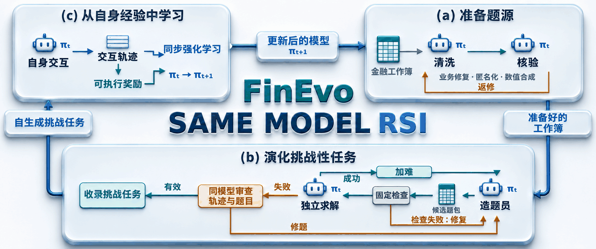

# FinEvo



**面向金融表格智能体递归自我改进的自生成挑战性任务**

[English](README.md) · **简体中文**

[引用](#引用) · [快速开始](#快速开始) · [浏览 20 道任务](examples/README.md) · [自主造题](generation/README.md) · [训练智能体](training/README.md)

**让模型参与创造自己接下来要学习的挑战。**

一个公式引用错误，就可能沿着预测、资产负债表和现金流，传导到公司的估值结果。金融表格智能体需要读懂贯穿整个工作簿的业务关系。FinEvo 把这样的工作簿变成模型自主创造新挑战、积累学习经验的起点。

从一份完整金融模型出发，让智能体尝试建模或查错；再依据这次尝试的反馈，改进下一道挑战，最后通过**同步 GRPO** 在收录的任务上学习。

| 创造挑战 | 读懂反馈 | 提升智能体 |
| --- | --- | --- |
| 从完整工作簿构造建模与调试任务。 | 阅读成功轨迹指导加难，审查失败以发现题目自身的问题。 | 利用模型自身的工具交互与可执行奖励开展训练。 |

默认目标模型为 **Qwen3.6-27B**，智能体框架为 **OpenHands**。仓库提供造题、评测与训练代码，以及**两份财务报表工作簿与 20 道任务**。

## 方法流程

1. **准备金融模型。** 清洗者与核验者在独立上下文中检查工作簿的业务关系，准备可用于造题的金融模型。
2. **迭代构造挑战。** 生成建模或调试任务，检查可执行产物，再由全新上下文中的求解者试做。成功轨迹用于指导加难；检查失败和求解失败后的审查用于指导重构或修题。经审查有效的挑战进入收录题集。
3. **通过自身经验学习。** 在收录任务上采集工具交互轨迹，利用二元整题奖励优化模型。同步采样使每批训练轨迹与当前策略保持一致。

仓库中的两份财务报表工作簿已完成准备，可以直接作为造题输入。对于新题源，也可以运行同模型清洗与核验流程。

## 两份工作簿，二十道挑战

两份虚构公司的模型包含相互联动的利润表、资产负债表、现金流量表、经营驱动和业务分部明细。每份题源提供 **5 道建模题和 5 道调试题**：

| 题源 | 完整工作簿 | 建模任务 | 调试任务 |
| --- | --- | --- | --- |
| **financialstatements1** | [工作簿](examples/financialstatements1/reference.xlsx) | [浏览任务](examples/financialstatements1/tasks/) | [阅读调试题](examples/financialstatements1/tasks/financialstatements1-debugging-001/instruction.md) |
| **financialstatements2** | [工作簿](examples/financialstatements2/reference.xlsx) | [浏览任务](examples/financialstatements2/tasks/) | [阅读调试题](examples/financialstatements2/tasks/financialstatements2-debugging-001/instruction.md) |

每道任务都包含输入工作簿、题目说明、参考解答与固定评分器。[浏览示例数据 →](examples/README.md)

## 仓库内容

| 模块 | 内容 | 详细说明 |
| --- | --- | --- |
| `generation/` | 清洗、核验、任务构造、加难与失败审查 | [造题指南](generation/README.md) |
| `evaluation/` | 独立 Harbor 评测与结果汇总 | [评测指南](evaluation/README.md) |
| `training/` | 同步 GRPO、固定版本的运行适配代码与训练配置 | [训练指南](training/README.md) |
| `examples/` | 两份题源及 10 道建模题、10 道调试题 | [示例数据](examples/README.md) |
| `results/` | 论文主实验的学习曲线与造题进度汇总 | [结果说明](results/README.md) |
| `scripts/` | 题源注册、训练任务调度、控制器配置与版本校验 | [辅助脚本](scripts/) |

## 快速开始

### 1. 安装

使用 **Python 3.12**。执行表格任务还需要 Docker 和 LibreOffice；造题与求解评测需要模型服务端点。GPU 训练所需的独立运行环境见[训练指南](training/README.md)。

```bash
git clone https://github.com/pcj-sudo/FinEvo.git
cd FinEvo

python3.12 -m venv .venv
source .venv/bin/activate
python -m pip install -e ./generation -e ./evaluation -e './training[controller,dev]'
python -m pip install -r generation/requirements-openhands.txt
```

### 2. 校验示例

```bash
python scripts/validate_release.py
```

该命令在本地检查题包、冻结文件哈希、训练配置和版本内容，不调用模型、不重算工作簿，也不启动 GPU 训练。

### 3. 配置模型服务

设置提供目标模型的 OpenAI 兼容接口：

```bash
export OPENAI_BASE_URL="http://localhost:8000/v1"
export OPENAI_API_KEY="your-api-key"
export LLM_BASE_URL="$OPENAI_BASE_URL"
export LLM_API_KEY="$OPENAI_API_KEY"
```

造题管线读取 `OPENAI_*`，独立 Harbor/OpenHands 评测读取 `LLM_*`。请将 [generation/configs/generation.json](generation/configs/generation.json) 和 [evaluation/configs/openhands.json](evaluation/configs/openhands.json) 中的模型名称与服务端保持一致。出题者和独立求解者须使用同一模型。

### 4. 造题或评测

注册第一份已准备好的财务报表工作簿，然后生成一道新的建模任务：

```bash
python scripts/import_prepared_source.py
rsi-generate --root generation --harness openhands run financialstatements1-new-modeling-001 \
  --source financialstatements1-example --type modeling --reuse-source
```

将 `--type` 改为 `debugging` 即可构造公式修复任务。新工作簿清洗、运行恢复与成品题导出见[造题指南](generation/README.md)。

评测仓库中的 20 道任务：

```bash
rsi-eval --root evaluation --config configs/openhands.json
```

默认配置对每题进行五次独立尝试。固定评分器重算提交的工作簿，仅在全部目标单元格正确时判定整题成功。执行时，参考工作簿和评分目标不会进入求解者的公开环境。

### 5. 同步 GRPO 训练

按[训练指南](training/README.md)准备控制器、模型权重和 GPU 运行环境。仓库提供两种配置：

| 配置 | 更新次数 | 每次更新的任务数 | 每题采样轨迹数 |
| --- | ---: | ---: | ---: |
| [财务报表示例](training/configs/demo.json) | 2 | 4 | 8 |
| [论文配置](training/configs/paper.json) | 8 | 32 | 8 |

当前分布式启动器使用六个八卡节点。示例配置缩小了数据量和更新次数，同时保留这一计算拓扑；论文配置需要另行提供获授权的完整数据集。

## 示例数据与实验范围

每份公开题源包含七张工作表及十道任务，按 **8 道训练题、2 道验证题**划分；两份题源合计 **16 道训练题、4 道验证题**。训练演示默认使用 `financialstatements1`，评测配置同时包含两个目录。论文实验包含来自 11 份题源的 110 道任务，RL 划分为 **88/22**。本仓库中的示例支持方法探索；完整训练结果的复现需要完整数据和模型访问权限。历史题源准备会话、模型权重及训练检查点未随仓库提供。

## 开发与检查

在仓库根目录运行 CPU 测试：

```bash
PYTHONPATH=generation/src:generation/tests:training/src:evaluation/src \
  python -m pytest generation/tests training/tests -q
```

GitHub Actions 模板位于 [ci/checks.yml](ci/checks.yml)。启用时，使用具备工作流管理权限的凭据将其复制到 `.github/workflows/`。

## 引用

如果你的研究使用了 FinEvo，请引用：

```bibtex
@misc{pan2026finevo,
  title  = {FinEvo: Self-Generated Challenging Tasks for Recursive Self-Improvement of Financial Spreadsheet Agents},
  author = {Pan, Chengjun and Liu, Shichun and Lin, Jiahang and Zhou, Zekai and Gui, Tao},
  year   = {2026},
  note   = {Preprint},
  url    = {https://github.com/pcj-sudo/FinEvo}
}
```

## 许可证

详见 [LICENSE](LICENSE) 与 [NOTICE](NOTICE)。仓库中的 Slime 运行时代码保留其[上游许可证](training/backend/slime/LICENSE)；外部依赖和模型权重遵循各自的许可条款。
